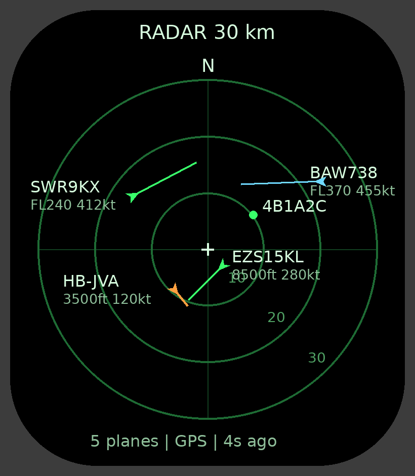

# zepp-apps

Custom Zepp OS apps for the Amazfit Cheetah (Square): Plane Radar.

## Plane Radar

A radar scope of the aircraft around you, north up. Each plane shows its callsign (or registration / ICAO hex), altitude and ground speed, plus a line showing where it will be in one minute. Colours: orange below 5,000 ft, green in between, cyan from FL250. Tap the screen to switch range: 15 → 30 → 60 → 120 km. Positions refresh every 8 s and are extrapolated in between.

- **Data**: the phone (through the Zepp app) queries [adsb.lol](https://adsb.lol), falling back to [airplanes.live](https://airplanes.live) and [adsb.fi](https://adsb.fi). All are free, community-run ADS-B networks with no API key. The query point is rounded to about 1 km.
- **Your position**: watch GPS when it has a fix. Otherwise the last fix from the past 6 hours, otherwise an approximate location from the phone's internet connection ([GeoJS](https://www.geojs.io)). The status line says which one is in use.
- Source in [`plane-radar/`](plane-radar/). Tests: `cd plane-radar && npm install && npm test`.

Install QR:

Backup:

### Build notes

- Built with `@zeppos/zeus-cli` 1.9.3 (`zeus build`), Zepp OS API 3.0, square 390 × 450, NXP chipset. Plane Radar uses `@zeppos/zml` for watch–phone messaging.
- The package is patched to `packageInfo.mode = "preview"` with a long expiry so it installs from a plain `zpkd1://` link, with no Zepp developer account.
- Square assets must live in `assets/default.s/`.
- Keep code synchronous: Zepp OS 3.x on the Cheetah Square is reported to crash on background async work.
